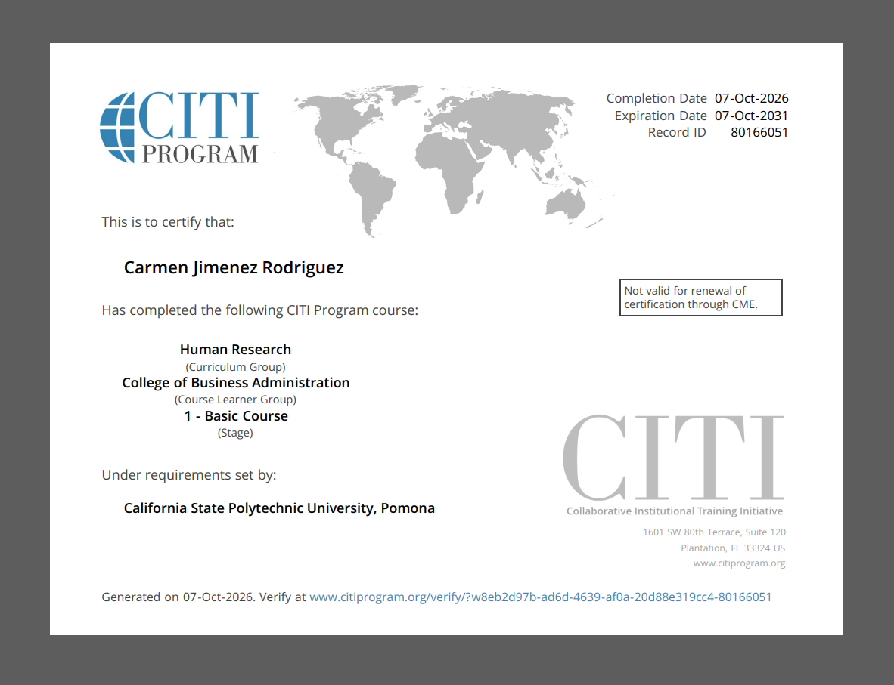

---
title: "IC8-2: CITI Certification"
author: "Carmen Jimenez"
date: "2026-10-07"

format:
  html:
    toc: true
    toc-title: "Contents"
    number-sections: true
    embed-resources: true
    theme: cosmo
---

# CITI Training

For this assignment, I completed the CITI Program training for the College of Business Administration at Cal Poly Pomona.

The course included several topics related to research with human subjects. Some of the main topics were informed consent, privacy and confidentiality, research risks, vulnerable populations, internet-based research, international research, and conflicts of interest.

The training also helped me understand more about the role of the Institutional Review Board (IRB) and why researchers need to receive approval before starting certain research projects.

# Certificate of Completion

Below is my CITI certificate showing that I completed the required training.

{width=85%}

# What I Learned

One of the main things I learned from this training is that researchers have a responsibility to protect the people who participate in their studies.

I learned that participation should be voluntary and that participants should understand what the study is about before agreeing to participate. I also learned why privacy and confidentiality are important, especially when researchers collect personal or sensitive information.
Another important part of the training was learning about the three main ethical principles of respect for persons, beneficence, and justice. These principles help guide researchers when working with human subjects.

Overall, the course helped me better understand the IRB process and the responsibilities involved in conducting research with people.

# Appendix

## Links

- [Cal Poly Pomona IRB](https://www.cpp.edu/research/research-compliance/irb/protocol.shtml)

- [CITI Program](https://www.citiprogram.org/)